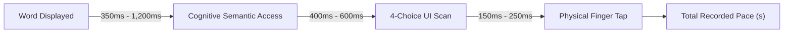
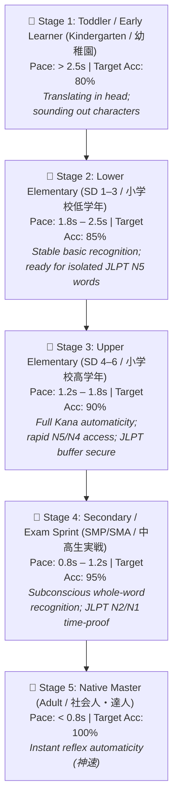
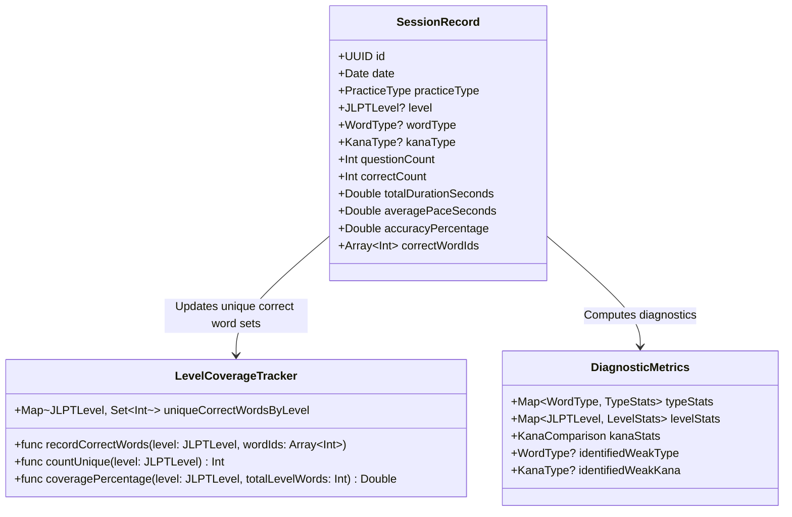

# Ganbatte Activity, Diagnostic Analytics & Dual-Axis Trophy System
*Final Master Specification — Version 4.0 (Pre-Implementation Baseline)*

> [!NOTE]
> This is the finalized master blueprint defining the exact statistical hierarchy, cognitive reading benchmarks, strict streak mechanics, and the **Dual-Axis Gamification Engine** across all five JLPT levels (**N5, N4, N3, N2, and N1**) and **Kana**. It serves as the definitive reference for implementation.

---

## 1. Executive Summary & Core Rules

1. **The Dual-Axis Gamification Engine:**
   - **Axis 1 (The Skill Path):** Progressive micro-stepping stones (**Nouns $\rightarrow$ Adjectives $\rightarrow$ Verbs $\rightarrow$ ALL**) across all levels (**N5 to N1**), combining strict **$\ge 90\%–100\%$ Accuracy** with native Japanese response pace targets.
   - **Axis 2 (The Coverage Path):** Cumulative dictionary milestones (**25/50 $\rightarrow$ 100 $\rightarrow$ 250 $\rightarrow$ 500 $\rightarrow$ 100% Cleared**) tracking unique words practiced.
2. **The "Correct-Answer" Coverage Rule:** A word **only** counts toward unique coverage if the user answers it **correctly at least once** in a quiz. Incorrect answers do not count toward coverage, preventing random speed-farming.
3. **Symmetrical JLPT Hierarchy:** Every JLPT level (**N5, N4, N3, N2, and N1**) features the exact same balanced suite of **9 medals** (4 Skill medals + 5 Coverage medals = 45 Kotoba medals total).
4. **Instant Dopamine Feedback:** Unlocked medals trigger a celebratory modal banner with haptic feedback immediately on the **Quiz Result Screen** (`ExerciseResultView` & `KanaExerciseResultView`).
5. **Hardcore Streak Discipline:** Zero freeze/shield cushions. Missing a calendar day strictly resets the streak counter to `0`.
6. **Future-Proof Extensibility:** The architecture is built to seamlessly onboard **Kanji** and **Bunpou (Grammar)** once those modules launch.

---

## 2. Scientific & Empirical Benchmarks

### A. Psycholinguistic Foundations: The Lexical Decision Task (LDT)
In cognitive psycholinguistics (e.g., *Kess & Miyamoto's "The Japanese Mental Lexicon"*; *Tamaoka et al.*; *Chikamatsu SLA research*), reading speeds are measured via visual lexical access:

- **Native Japanese Adults:** Direct visual orthographic retrieval takes **350ms – 550ms (0.35s – 0.55s)** for core vocabulary.
- **Japanese Elementary Students (Grades 1–3):** Takes **750ms – 1,100ms (0.75s – 1.1s)**.
- **L2 Second Language Learners:**
  - *Translating in Head (Phonological Recoding):* $1,800\text{ms} – 2,800\text{ms}$ (letter-by-letter sound decoding $\rightarrow$ English mental translation $\rightarrow$ meaning).
  - *Automaticity (Direct Semantic Access):* $800\text{ms} – 1,300\text{ms}$ (instant holistic word recognition).

### B. UI Response & Motor Latency Model
Because the app uses a 4-choice interactive interface, the total measured response time accounts for human cognitive and motor latency:

$$\text{Measured Response Time} = \text{Visual Word Recognition} + \text{4-Choice Visual Scan (Hick's Law)} + \text{Motor Touch Latency}$$

- **Choice Reaction Time (Hick-Hyman Law):** Scanning 4 multiple-choice cards on a mobile viewport adds $\approx \mathbf{400\text{ms} – 600\text{ms}}$.
- **Physical Motor Latency:** Finger motion to screen contact adds $\approx \mathbf{150\text{ms} – 250\text{ms}}$.

### C. Official JLPT Examination Time Budgets
- **JLPT N5 / N4:** Candidates have $\approx 36\text{s}$ per question. Official guidelines require isolated word recognition in **$\le 1.8\text{s} – 2.2\text{s}$**, preserving the remaining 30+ seconds for context parsing and reading passages (*Dokkai*).
- **JLPT N2 / N1:** Tightest time pressure (110 minutes for $\approx 20,000$ characters). Discrete vocabulary recognition must be instantaneous (**$< 1.0\text{s} – 1.2\text{s}$**) to prevent running out of time on long reading articles.

### D. Linguistic Differential: Why Verbs Require Dedicated Calibration
- **Nouns** are concrete referential entities (犬, 車, 部屋) retrieved quickest ($\approx 400\text{ms}$ in natives).
- **Adjectives** represent attributes, colors, and subjective states (高い, 静か, 新しい).
- **Verbs** are relational and inflectional (食べる, 行く, 話す). In L2 learners, verb processing takes an average of **$200\text{ms} – 400\text{ms}$ longer** than nouns.
- *Benchmark standard:* Answering Verbs under **$1.5\text{s}$** with $\ge 90\%$ accuracy validates inflectional mastery under time pressure.

---

## 3. The 5-Stage Native Fluency Ladder

---

## 4. The Dual-Axis Gamification Engine

```mermaid
flowchart TD
    subgraph Axis1["Axis 1: The Skill Path (Reflex & Speed + Accuracy)"]
        S1["Step 1: Nouns (Concrete / Confidence Builder)"] --> S2["Step 2: Adjectives (Descriptive / Qualifiers)"]
        S2 --> S3["Step 3: Verbs (Action / Conjugation Engine)"]
        S3 --> S4["Step 4: ALL (The Pinnacle / Real Exam Simulation)"]
    end

    subgraph Axis2["Axis 2: The Coverage Path (Unique Words Answered Correctly)"]
        C1["Tier 1: 25 / 50 Unique Words"] --> C2["Tier 2: 50 / 100 Unique Words"]
        C2 --> C3["Tier 3: 100 / 250 Unique Words"]
        C3 --> C4["Tier 4: 250 / 500 Unique Words"]
        C4 --> C5["Tier 5: 100% Level Cleared (Completionist Titan)"]
    end
```

---

## 5. Screen Architecture & Visual Hierarchy

```mermaid
flowchart TD
    Header["Screen Header: Activity, Subtitle, Total Workouts Badge"]
    StreakHero["1. Streak & Daily Momentum (Strictly Hardcore Unbroken)"]
    PaceCard["2. Reaction Pace & Speed Card (vs Native Benchmarks)"]
    DiagnosticCard["3. Weakness Spotlight & Diagnostic Radar"]
    LevelCarousel["4. Level Mastery Carousel (N5 - N1 Horizontal Swipe Cards)"]
    VolumeCard["5. Weekly Practice Volume (Mon–Sun Active Time)"]
    TrophyHighlights["6. Trophy Highlights (Dashboard Showcase)"]
    TrophyCabinet["7. Dedicated Trophy Cabinet (Full Interactive Room)"]

    Header --> StreakHero
    StreakHero --> PaceCard
    PaceCard --> DiagnosticCard
    DiagnosticCard --> LevelCarousel
    LevelCarousel --> VolumeCard
    VolumeCard --> TrophyHighlights
    TrophyHighlights -.->|"Tap 'View All >'"| TrophyCabinet

    subgraph DiagnosticCard["3. Weakness Spotlight & Diagnostic Radar"]
        CategoryTabs["Category Switcher: Kotoba | Kana"]
        KotobaStats["Kotoba: Noun vs Verb vs Adj Performance"]
        KanaStats["Kana: Hiragana vs Katakana Head-to-Head"]
        FocusAction["⚠️ Automated Weakness Tag + 1-Tap Direct Practice Launcher"]
    end

    subgraph TrophyHighlights["6. Trophy Highlights (Dashboard Showcase)"]
        HighlightHeader["Header: 'X of 57 Unlocked' + 'View All >' Button"]
        RecentUnlocks["Recently Earned (Top 3 Badges)"]
        NextToUnlock["Next to Unlock (Live Progress Bars)"]
    end

    subgraph TrophyCabinet["7. Dedicated Trophy Cabinet (Full Interactive Room)"]
        CabinetHero["Catalog Meter: Total Unlocked (X%) + 5-Tier Chip Matrix"]
        CabinetFilters["Filter Pills: All | N5 | N4 | N3 | N2 | N1 | Kana | Habits"]
        StatusToggle["Status Filter: All | Unlocked | Locked"]
        MedalGrid["Coupled Badges (Bronze, Silver, Gold, Platinum, Diamond)"]
    end
```

---

## 6. Detailed Component Specifications

### 1. Streak & Daily Momentum Hero Card
- **Strictly Hardcore Policy:** Requires completing at least 1 legitimate workout every calendar day before 23:59. Missing a day resets the counter strictly to `0`.
- **Display:** Large bold day streak count + flame badge.
- **7-Day Track:** Circular progress for Monday through Sunday.
- **Today's Active Time:** Total workout time recorded today (e.g. `14m 20s`).

### 2. Reaction Pace Card (Benchmark-Aware)
- **Current Average Pace:** Mean response time formatted as `X.Xs / question`.
- **Native Benchmark Gauge:** Context badge displaying the user's current reading bracket (e.g., `"Lower Elementary (SD 1–3) Pace"`, `"JLPT Exam-Ready Pace"`).
- **Personal Best (PB):** Fastest average pace meeting qualification thresholds ($\ge 10$ questions, $\ge 90\%$ accuracy).
- **Rolling Pace Trend:** Compares last 3 workouts against prior 5 workouts (e.g., `🟢 14% faster`).

### 3. Weakness Spotlight & Diagnostic Radar
- **Category Toggle:** `[ Kotoba ]` | `[ Kana ]`
- **When Kotoba is selected:**
  - **Word Type Radar:** Nouns, Verbs, Adjectives with Accuracy %, Average Pace, and Words Practiced.
  - **Automated Weakness Callout:** Highlights lagging dimension:
    > ⚠️ **Focus Recommendation: Verbs**  
    > Your Verb pace is 3.1s (68% acc) vs. Nouns at 1.4s (94% acc).
    > `[ Train Verbs Now ➔ ]` *(1-tap button launches ExerciseHub with Kotoba pre-configured to Verbs)*
- **When Kana is selected:**
  - Compares Hiragana and Katakana side-by-side. Highlights Katakana hesitation with `[ Practice Katakana ➔ ]`.

### 4. Level Mastery Strip (Horizontal Carousel)
- Horizontal snapping cards capped at $\approx 110\text{pt}$ vertical height:
  - **Card 1 (N5):** `[ Noun ✅ ] [ Adj ✅ ] [ Verb ⏳ ] [ All 🔒 ]` • `Coverage: 180 / 530 (34%)`
  - **Card 2 (N4):** `[ Noun ⏳ ] [ Adj 🔒 ] [ Verb 🔒 ] [ All 🔒 ]` • `Coverage: 40 / 521 (8%)`
  - **Card 3 (N3):** `[ Noun 🔒 ] [ Adj 🔒 ] [ Verb 🔒 ] [ All 🔒 ]` • `Coverage: 0 / 1818 (0%)`
  - **Card 4 (N2):** `[ Noun 🔒 ] [ Adj 🔒 ] [ Verb 🔒 ] [ All 🔒 ]` • `Coverage: 0 / 1398 (0%)`
  - **Card 5 (N1):** `[ Noun 🔒 ] [ Adj 🔒 ] [ Verb 🔒 ] [ All 🔒 ]` • `Coverage: 0 / 2435 (0%)`

### 5. Exercise Hub Continuity Badge
- Under `JLPT LEVEL` in the Exercise Hub, displays:
  `"160 Words Available • 34% Cleared"` (showing current level's unique coverage).

### 6. Post-Quiz Victory Banner
- On `ExerciseResultView` & `KanaExerciseResultView`:
  - When a session triggers new medal unlocks, displays a celebratory modal banner with the medal icon, title, tier badge, and haptic feedback before the user returns to the main screens.

### 7. Trophy Highlights Card (Dashboard Showcase)
- **Compact Footprint:** Prevents page bloat by replacing the 57-item vertical list with a punchy $\approx 220\text{pt}$ executive showcase.
- **Components:**
  - Header with Trophy badge, `X of 57 Unlocked`, and a `View All ›` capsule button.
  - **Recently Earned:** Displays the latest unlocked trophies or a cheerful onboarding prompt if none are unlocked yet.
  - **Next to Unlock (In Progress):** Dynamically calculates and displays the user's top 2 closest goals (e.g. `N5 First Strides 18/25 words (72%)` or `7-Day Iron Will 3/7 days (43%)`) with live progress bars.

### 8. Dedicated Trophy Cabinet (The Trophy Room)
- **Full-Screen Interactive Room:** Accessible via `View All ›` from the dashboard.
- **Components:**
  - Header with `< Activity` back button and total unlocked stats.
  - **Hero Progress Card:** Progress bar for the overall 57-trophy catalog + 5-tier chip matrix (Bronze, Silver, Gold, Platinum, Diamond).
  - **Category Filter Bar:** `All (57)`, `N5 (9)`, `N4 (9)`, `N3 (9)`, `N2 (9)`, `N1 (9)`, `Kana (5)`, `Habits (7)`.
  - **Status Filter Bar:** `All`, `Unlocked`, `Locked`.
  - **3-Column Medal Grid:** Displays rich cards with tier color halos, live progress bars, unlock dates, and 1-tap detail modal inspectors.

---

## 7. Master Dual-Axis Medals Catalog (Symmetrical N5–N1)

Filter Pills: `[ All ]  [ N5 ]  [ N4 ]  [ N3 ]  [ N2 ]  [ N1 ]  [ Kana ]  [ Habits & Speed ]`

### A. JLPT N5 Medals (Syllabus: 530 Words)

| ID | Title | Axis | Tier | Criteria | Grounding / Real-World Meaning |
| :--- | :--- | :--- | :--- | :--- | :--- |
| `n5_noun_ace` | **N5 Noun Explorer** | Skill | 🥉 Bronze | $\ge 90\%$ Acc • $< 1.5\text{s}$ (20 Nouns) | Elementary concrete noun recall |
| `n5_adj_ace` | **N5 Adjective Scout** | Skill | 🥉 Bronze | $\ge 90\%$ Acc • $< 1.6\text{s}$ (20 Adjectives) | Attribute & state recognition |
| `n5_verb_ace` | **N5 Verb Novice** | Skill | 🥈 Silver | $\ge 90\%$ Acc • $< 1.8\text{s}$ (20 Verbs) | Action verbs without hesitation |
| `n5_grandmaster`| **N5 Grandmaster (All)**| Skill | 🥇 Gold | $\ge 95\%$ Acc • $< 1.3\text{s}$ (30 Mixed N5) | Full N5 synthesis at elementary reading pace |
| `n5_cov_25` | **N5 First Strides** | Coverage | 🥉 Bronze | 25 unique N5 words answered correctly | First 2–3 batches conquered |
| `n5_cov_50` | **N5 Gaining Momentum** | Coverage | 🥉 Bronze | 50 unique N5 words answered correctly | 5 full batches cleared |
| `n5_cov_100` | **N5 Century Mark** | Coverage | 🥈 Silver | 100 unique N5 words answered correctly | 10 full batches cleared |
| `n5_cov_250` | **N5 Halfway Hero** | Coverage | 🥇 Gold | 250 unique N5 words answered correctly | $\approx 50\%$ of the entire N5 dictionary |
| `n5_cov_full` | **N5 Completionist** | Coverage | 💎 Platinum | All 530 unique N5 words answered correctly | 100% of N5 syllabus covered |

---

### B. JLPT N4 Medals (Syllabus: 521 Words)

| ID | Title | Axis | Tier | Criteria | Grounding / Real-World Meaning |
| :--- | :--- | :--- | :--- | :--- | :--- |
| `n4_noun_ace` | **N4 Noun Runner** | Skill | 🥉 Bronze | $\ge 90\%$ Acc • $< 1.4\text{s}$ (20 Nouns) | Rapid N4 noun recall |
| `n4_adj_ace` | **N4 Adjective Sprinter**| Skill | 🥉 Bronze | $\ge 90\%$ Acc • $< 1.5\text{s}$ (20 Adjectives) | Complex descriptive recall |
| `n4_verb_ace` | **N4 Verb Strider** | Skill | 🥈 Silver | $\ge 90\%$ Acc • $< 1.6\text{s}$ (20 Verbs) | Compound verb & transitive pair processing |
| `n4_grandmaster`| **N4 Grandmaster (All)**| Skill | 🥇 Gold | $\ge 95\%$ Acc • $< 1.2\text{s}$ (30 Mixed N4) | Upper elementary native reading speed |
| `n4_cov_25` | **N4 First Strides** | Coverage | 🥉 Bronze | 25 unique N4 words answered correctly | First 2–3 batches conquered |
| `n4_cov_50` | **N4 Gaining Momentum** | Coverage | 🥉 Bronze | 50 unique N4 words answered correctly | 5 full batches cleared |
| `n4_cov_100` | **N4 Century Mark** | Coverage | 🥈 Silver | 100 unique N4 words answered correctly | Solid N4 base |
| `n4_cov_250` | **N4 Halfway Hero** | Coverage | 🥇 Gold | 250 unique N4 words answered correctly | Halfway through N4 syllabus |
| `n4_cov_full` | **N4 Completionist** | Coverage | 💎 Platinum | All 521 unique N4 words answered correctly | 100% of N4 syllabus covered |

---

### C. JLPT N3 Medals (Syllabus: 1,818 Words)

| ID | Title | Axis | Tier | Criteria | Grounding / Real-World Meaning |
| :--- | :--- | :--- | :--- | :--- | :--- |
| `n3_noun_ace` | **N3 Noun Navigator** | Skill | 🥈 Silver | $\ge 92\%$ Acc • $< 1.3\text{s}$ (25 Nouns) | Intermediate conversational nouns |
| `n3_adj_ace` | **N3 Adjective Specialist**| Skill| 🥈 Silver | $\ge 92\%$ Acc • $< 1.4\text{s}$ (25 Adjectives) | Advanced emotional/descriptive nuances |
| `n3_verb_ace` | **N3 Verb Virtuoso** | Skill | 🥇 Gold | $\ge 92\%$ Acc • $< 1.5\text{s}$ (25 Verbs) | Rapid polite, passive & causative processing |
| `n3_grandmaster`| **N3 Grandmaster (All)**| Skill | 💎 Platinum | $\ge 95\%$ Acc • $< 1.1\text{s}$ (35 Mixed N3) | Fluent junior high reading automaticity |
| `n3_cov_50` | **N3 First Strides** | Coverage | 🥉 Bronze | 50 unique N3 words answered correctly | Early intermediate foundation |
| `n3_cov_100` | **N3 Century Mark** | Coverage | 🥈 Silver | 100 unique N3 words answered correctly | 100 intermediate words |
| `n3_cov_250` | **N3 Solid Base** | Coverage | 🥈 Silver | 250 unique N3 words answered correctly | Conversational breadth |
| `n3_cov_500` | **N3 Halfway Hero** | Coverage | 🥇 Gold | 500 unique N3 words answered correctly | Substantial N3 mastery |
| `n3_cov_full` | **N3 Completionist** | Coverage | 💎 Platinum | All 1,818 unique N3 words answered correctly | Complete N3 syllabus conquered |

---

### D. JLPT N2 Medals (Syllabus: 1,398 Words)

| ID | Title | Axis | Tier | Criteria | Grounding / Real-World Meaning |
| :--- | :--- | :--- | :--- | :--- | :--- |
| `n2_noun_ace` | **N2 Noun Scholar** | Skill | 🥈 Silver | $\ge 92\%$ Acc • $< 1.2\text{s}$ (25 Nouns) | Business & academic abstract nouns |
| `n2_adj_ace` | **N2 Adjective Expert** | Skill | 🥈 Silver | $\ge 92\%$ Acc • $< 1.3\text{s}$ (25 Adjectives) | Nuanced formal descriptive terms |
| `n2_verb_ace` | **N2 Verb Commander** | Skill | 🥇 Gold | $\ge 92\%$ Acc • $< 1.4\text{s}$ (25 Verbs) | Formal written & compound verbs |
| `n2_grandmaster`| **N2 Grandmaster (All)**| Skill | 💎 Platinum | $\ge 95\%$ Acc • $< 1.0\text{s}$ (35 Mixed N2) | High school / business reading automaticity |
| `n2_cov_50` | **N2 First Strides** | Coverage | 🥉 Bronze | 50 unique N2 words answered correctly | Upper-intermediate gateway |
| `n2_cov_100` | **N2 Century Mark** | Coverage | 🥈 Silver | 100 unique N2 words answered correctly | Solid advanced base |
| `n2_cov_250` | **N2 Solid Base** | Coverage | 🥈 Silver | 250 unique N2 words answered correctly | Deep professional vocabulary |
| `n2_cov_500` | **N2 Halfway Hero** | Coverage | 🥇 Gold | 500 unique N2 words answered correctly | Near-exam readiness |
| `n2_cov_full` | **N2 Completionist** | Coverage | 💎 Platinum | All 1,398 unique N2 words answered correctly | Complete N2 syllabus conquered |

---

### E. JLPT N1 Medals (Syllabus: 2,435 Words)

| ID | Title | Axis | Tier | Criteria | Grounding / Real-World Meaning |
| :--- | :--- | :--- | :--- | :--- | :--- |
| `n1_noun_ace` | **N1 Noun Titan** | Skill | 🥇 Gold | $\ge 95\%$ Acc • $< 1.1\text{s}$ (30 Nouns) | Literary, political & formal terminology |
| `n1_adj_ace` | **N1 Adjective Sage** | Skill | 🥇 Gold | $\ge 95\%$ Acc • $< 1.2\text{s}$ (30 Adjectives) | Complex literary expressions |
| `n1_verb_ace` | **N1 Verb Emperor** | Skill | 🥇 Gold | $\ge 95\%$ Acc • $< 1.3\text{s}$ (30 Verbs) | Classical & rare formal action verbs |
| `n1_grandmaster`| **N1 Kami (神速 Master)**| Skill | 👑 Diamond | $100\%$ Acc • $< 0.8\text{s}$ (40 Mixed N1) | Native adult reflex automaticity |
| `n1_cov_50` | **N1 First Strides** | Coverage | 🥉 Bronze | 50 unique N1 words answered correctly | Entering highest tier |
| `n1_cov_100` | **N1 Century Mark** | Coverage | 🥈 Silver | 100 unique N1 words answered correctly | Elite vocabulary base |
| `n1_cov_250` | **N1 Solid Base** | Coverage | 🥈 Silver | 250 unique N1 words answered correctly | Sophisticated Japanese literacy |
| `n1_cov_500` | **N1 Halfway Hero** | Coverage | 🥇 Gold | 500 unique N1 words answered correctly | Deep literary command |
| `n1_cov_full` | **N1 Completionist** | Coverage | 👑 Diamond | All 2,435 unique N1 words answered correctly | Master of the Japanese Lexicon |

---

### F. Kana Medals (Hiragana & Katakana)

| ID | Title | Tier | Criteria | Grounding / Real-World Meaning |
| :--- | :--- | :--- | :--- | :--- |
| `kana_hira_elem` | **Hiragana Elementary** | 🥉 Bronze | $\ge 90\%$ Acc • $< 1.8\text{s}$ (20 Hiragana) | Basic phonetic decoding |
| `kana_hira_rapid`| **Hiragana Rapid** | 🥈 Silver | $\ge 95\%$ Acc • $< 1.2\text{s}$ (30 Hiragana) | Subconscious syllable recognition |
| `kana_kata_break`| **Katakana Breakthrough**| 🥉 Bronze | $\ge 85\%$ Acc • $< 1.8\text{s}$ (20 Katakana) | Overcoming non-native Katakana lag |
| `kana_kata_master`| **Katakana Conqueror** | 🥇 Gold | $\ge 95\%$ Acc • $< 1.1\text{s}$ (30 Katakana) | Native Japanese Katakana recall speed |
| `kana_godspeed` | **Kana Godspeed (神速)** | 💎 Platinum | $100\%$ Acc • $< 0.8\text{s}$ (40 Mixed Kana) | Instant reflex automaticity (Adult Native) |

---

### G. Habit, Volume & Reflex Medals

| ID | Title | Tier | Criteria | Grounding / Real-World Meaning |
| :--- | :--- | :--- | :--- | :--- |
| `streak_7` | **Week Warrior** | 🥈 Silver | 7-day unbroken streak | 1 unbroken week of daily practice |
| `streak_14` | **Fortnight Focus** | 🥈 Silver | 14-day unbroken streak | 2 unbroken weeks of daily discipline |
| `streak_30` | **Monthly Discipline** | 🥇 Gold | 30-day unbroken streak | 1 full month of unbroken habit |
| `streak_100` | **Centurion Legend** | 💎 Platinum | 100-day unbroken streak | Elite language learning discipline |
| `vol_500` | **Dedicated Scholar** | 🥈 Silver | 500 total questions answered | Practice volume milestone |
| `vol_1000` | **Vocabulary Titan** | 🥇 Gold | 1,000 total questions answered | Deep immersion volume |
| `reflex_sub1` | **Sub-Second Reflex** | 💎 Platinum | $100\%$ Acc • $< 1.0\text{s}$ (20 questions) | Elite high-speed cognitive processing |

---

## 8. Data Architecture & Persistence Model

### 1. Storage & Unique Correct Word Tracking:
- `ActivityService` maintains a persistent dictionary in `UserDefaults`:
  `ganbatte_unique_correct_words_by_level: [String: [Int]]`
- When a quiz completes:
  1. Filters session results for `result.isCorrect == true`.
  2. Extracts the `word.id` for each correct answer.
  3. Inserts IDs into the corresponding `level` set.
- Coverage calculation is instantaneous and accurate:
  $$\text{Coverage \%} = \frac{\text{uniqueCorrectCount}}{\text{totalWordsInLevel}} \times 100$$

### 2. Backward Compatibility Guarantee:
- All new fields (`level`, `wordType`, `kanaType`, `correctWordIds`) in `SessionRecord` are Swift optionals (`?`).
- Existing saved sessions in `UserDefaults` (`ganbatte_activity_sessions_v1`) load smoothly without schema migrations or clearing past user activity.
