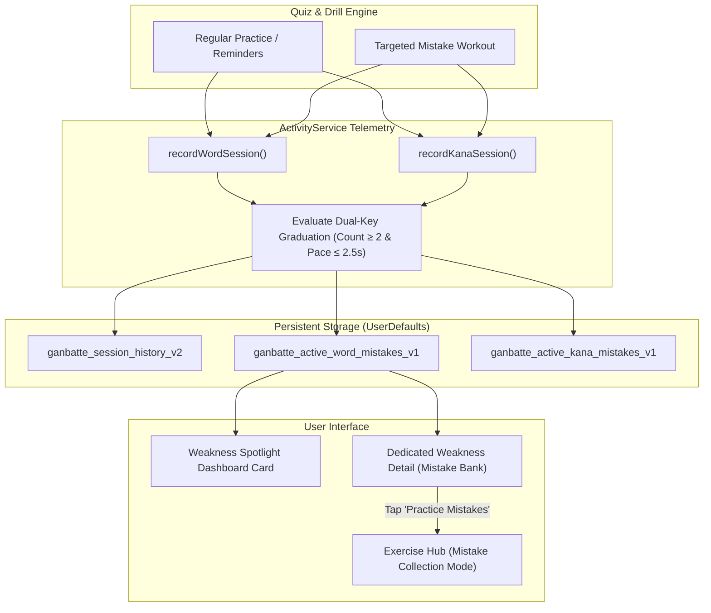

# Ganbatte Weakness Spotlight, Mistake Bank & Adaptive Remediation Specification
*Master Architecture Blueprint & Implementation Specification — Version 1.0*

> [!NOTE]
> This master blueprint defines the end-to-end architecture, cognitive graduation mechanics, data models, and unified Exercise Hub routing for Ganbatte's **Weakness Spotlight & Mistake Bank System**.

---

## 1. Executive Summary & Core Rules

1. **The Complete Cognitive Loop:**
   - Every quiz taken anywhere in Ganbatte (regular drills, scheduled reminder workouts, or dedicated mistake quizzes) feeds a **unified vocabulary mistake brain**.
   - Incorrect answers in any quiz automatically register into the **Mistake Bank** with persistent tracking (`failCount`, `lastFailedAt`, `consecutiveCleanCount`).
2. **The "Dual-Key" Graduation Rule (Option 1):**
   - A weak word or kana is officially cleared and graduated from the Mistake Bank when:
     1. **Accuracy:** Answered correctly **2 consecutive times**.
     2. **Reaction Speed:** Answered in **$\le 2.5$ seconds** (demonstrating direct automatic retrieval without mental translation or hesitating/guessing).
   - *If an answer is correct but $> 2.5\text{s}$*: It registers as correct, but marks hesitation, requiring one more clean speed run.
   - *If an answer is incorrect*: Consecutive clean count resets to `0` and `failCount` increments.
3. **Passive & Active Healing:**
   - **Passive Healing (Practice Biasa):** When a previously failed word randomly appears in your regular daily drills or scheduled reminders and you answer it in $\le 2.5\text{s}$, the Mistake Bank automatically credits it (`0/2 ➔ 1/2 ➔ 2/2 Cleared!`).
   - **Active Accelerated Healing (Practice Mistakes):** A dedicated workout mode that generates a quiz consisting **100% exclusively of your active mistake words**, allowing rapid elimination of weaknesses.
4. **Unified Exercise Hub Routing:**
   - Tapping **`[ ⚡ Practice Mistakes ]`** routes directly to the familiar **Exercise Hub (`ExerciseHubView`)**.
   - All normal dictionary filters (**JLPT Level**, **Word Type**, **Word Range 1–50**) are hidden.
   - Replaced by a focused **"Mistake Workout" Banner** (`⚡ Mistake Workout: X Target Words Loaded`).
   - Users retain full flexibility to choose question formats:
     - 🖼️ **Image & Meaning** (Visual/semantic recall)
     - 🎧 **Audio Listening** (Ear training for failed words)
     - ⌨️ **Fill-in / Typing** (Active production)
5. **Dashboard Radar Self-Healing:**
   - As words graduate, overall category accuracy (`Noun`, `Verb`, `Adjective`) rises.
   - When accuracy reaches $\ge 85\%$ and pace $< 2.0\text{s}$, the dashboard ⚠️ warning banner automatically transforms into a 🏆 **Balanced Mastered Radar**.

---

## 2. Telemetry & Data Architecture



### Data Models in `Models/ActivityModels.swift`:

```swift
// MARK: - Word Mistake Entry
struct WordMistakeEntry: Codable, Identifiable, Equatable {
    var id: Int { wordId }
    let wordId: Int
    let level: JLPTLevel
    let wordType: WordType
    var failCount: Int
    var consecutiveCleanCount: Int // Needs 2 consecutive answers at <= 2.5s
    var lastFailedAt: Date
    var isResolved: Bool
    
    var graduationProgress: Double {
        min(1.0, Double(consecutiveCleanCount) / 2.0)
    }
}

// MARK: - Kana Mistake Entry
struct KanaMistakeEntry: Codable, Identifiable, Equatable {
    var id: String { "\(script.rawValue)_\(character)" }
    let character: String
    let romaji: String
    let script: KanaType
    var failCount: Int
    var slowCount: Int // Hesitation > 2.5s
    var consecutiveCleanCount: Int
    var lastFailedAt: Date
    var isResolved: Bool
}
```

---

## 3. UI Hierarchy & User Experience

### A. Dashboard Card (`ActivityDashboardView.swift`)
- When unresolved mistakes exist in the Mistake Bank:
  - Display an interactive callout banner below the 3 boxes:
    ```
    ┌──────────────────────────────────────────────────────────────┐
    │ ⚠️  12 Troublesome Words Recorded                            │
    │     Focus needed on N4 Verbs & Adjectives                    │
    │                                      [ Review Mistakes ➔ ]   │
    └──────────────────────────────────────────────────────────────┘
    ```
  - Tapping **`[ Review Mistakes ➔ ]`** opens `WeaknessDetailView`.

### B. Dedicated Detail Screen (`WeaknessDetailView.swift`)
- Standard back button: `< Back` (`18pt semibold`, `AppTheme.accent`, matching `WordDetailView` & `TrophyCabinetView`).
- **Hero Banner:**
  - `[ ⚡ Practice Mistakes (12 Words) ]` — high energy CTA button.
- **Segmented Control:**
  - `[ Kotoba (12) | Kana (4) ]`
- **Kotoba Sub-filters:**
  - Level pills: `[ All (12) ]` `[ N5 (4) ]` `[ N4 (8) ]`
- **Word Mistake Cards List:**
  - Thumbnail image ($64\times 64\text{pt}$).
  - Kanji & Kana headline, English definition.
  - Frequency badge: `[ Missed 3x ]` (warm terracotta).
  - Clean Dual-Key status pill:
    - `🔴 0/2 Clean` (Needs Review)
    - `🟡 1/2 Clean` (In Progress)
  - Audio pronunciation button (native Japanese voice).
  - Tapping card opens full [WordDetailView](file:///Users/ilyasbashirah/Documents/kerja/bas.co/pictango/ganbatte/Views/WordDetailView.swift).
- **Kana Grid:**
  - Troublesome characters grid (e.g. `ツ`, `シ`, `ソ`, `ン`) with error rate and hesitation latency badge.
  - Interactive "⚡ Practice Kana Mistakes (N)" CTA routing directly into Exercise Hub.

### C. Unified Exercise Hub Routing (`ExerciseHubView.swift`)
1. **Kotoba Mistake Workout:**
   - Launched via `ganbatte_shortcut_to_mistakes` or `ActivityService.shared.pendingMistakeWorkoutWordIds`.
   - Suppresses normal Level, Type, and Range selectors.
   - Displays top banner: `⚡ Mistake Workout: X Target Words Loaded [✕ Exit]`.
   - Retains Question Format selectors (`Image & Meaning`, `Audio Listening`, `Fill-in / Typing`).
   - Generates questions exclusively from active mistake IDs.
   - Standard unified CTA button: `Start Quiz (N Questions)` with `play.fill` and standard `AppTheme.accent` styling.
   - Reset: Tapping `[✕ Exit]` clears `mistakeDrillWordIds`, restores standard dictionary filters, and reverts to regular exercise mode.
   - Automatically evaluates the Dual-Key graduation rule upon submission.

2. **Kana Mistake Smart Filter Workout:**
   - Launched via `ganbatte_shortcut_to_kana_mistakes` or `ActivityService.shared.pendingKanaMistakeWorkoutCharacters`.
   - Automatically activates the `.kana` category tab.
   - Suppresses general character set selection (Basic, Dakuon, Combo) and replaces it with:
     `⚡ KANA MISTAKE WORKOUT: Targeting X, Y [✕ Exit]` banner.
   - Drills are generated using smart character matching (`fetchKanaWordsContaining(characters:type:limit:)`), ensuring 100% of tested vocabulary contains the user's specific weak Kana characters.
   - Fast Romaji typing speed drill format with question count selector (10, 20, 30, 50).
   - Standard unified CTA button: `Start Quiz (N Questions)` with `play.fill` and standard `AppTheme.accent` styling.
   - Reset: Tapping `[✕ Exit]` clears `mistakeKanaCharacters`, restores standard Kana script selectors, and reverts to regular exercise mode.
   - Dual-Key graduation rule evaluated on each character answer.

### D. Typography & Icon Alignment Standards
- **Guidance & Rule Callouts:**
  - All banners and footnotes pairing an SF Symbol with explanatory text (e.g. Dual-Key graduation rule, Romaji typing instructions, character filter tags) must use top-aligned layout:
    ```swift
    HStack(alignment: .top, spacing: 6) {
        Image(systemName: "shield.lefthalf.filled")
            .font(.system(size: 12))
            .padding(.top, 1.5)
        Text("Dual-Key Rule: ...")
    }
    ```
  - This prevents icons from awkwardly floating centered between multiple wrapped lines of text on smaller screen widths.
- **Card Headers:**
  - Header icons (such as `cross.circle.fill` in `WEAKNESS SPOTLIGHT & RADAR`) are scaled to match the font size and baseline of uppercase headers, aligning flush with interactive pills (e.g. `[ Kotoba | Kana ]`).
